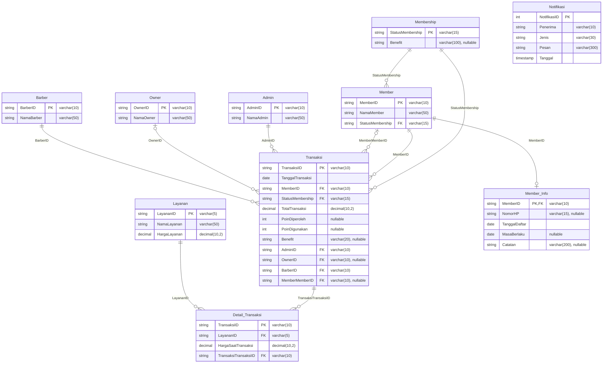

# ERD Menza Membership

| Nama tabel | Primary key | Foreign key |
|---|---|---|
| `Admin` | `AdminID` | — |
| `Barber` | `BarberID` | — |
| `Owner` | `OwnerID` | — |
| `Membership` | `StatusMembership` | — |
| `Member` | `MemberID` | `StatusMembership` → `Membership.StatusMembership` |
| `Layanan` | `LayananID` | — |
| `Transaksi` | `TransaksiID` | `MemberID` → `Member.MemberID`; `MemberMemberID` → `Member.MemberID` (opsional); `StatusMembership` → `Membership.StatusMembership`; `AdminID` → `Admin.AdminID`; `OwnerID` → `Owner.OwnerID` (opsional); `BarberID` → `Barber.BarberID` |
| `Detail_Transaksi` | `TransaksiID` | `LayananID` → `Layanan.LayananID`; `TransaksiTransaksiID` → `Transaksi.TransaksiID` |
| `Member_Info` | `MemberID` | `MemberID` → `Member.MemberID` |
| `Notifikasi` | `NotifikasiID` | — |
